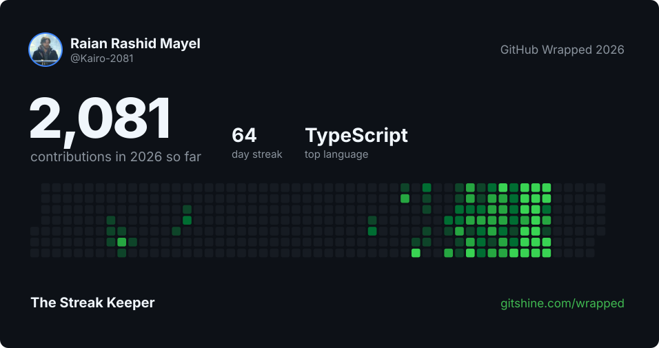

<!-- HEADER BANNER -->

<!-- TYPING ANIMATION -->

  CSE undergraduate at BUET, based in Dhaka, Bangladesh. 
  Building full-stack web applications. Teaching, mentoring, and competing in case-solving events.

  
  &nbsp;&nbsp;
  
  &nbsp;&nbsp;
  
  &nbsp;&nbsp;
  

<!-- COSMOS QUOTE -->

  

---

### Now

- **B.Sc. in Computer Science and Engineering**, Bangladesh University of Engineering and Technology (2025 to 2029). Currently in my 2nd year
- **Online Instructor and Question Setter / Proofreader** (part-time) at Achieve EdTech, an edtech platform for engineering admission preparation. I record problem-solving masterclasses and write Mathematics and Physics assessments for the admission batch
- **Independent tutor and mentor** since 2025: private tutoring in Mathematics, Physics, Chemistry and Science up to SSC level, remote mentoring for engineering admission candidates, and a first-year Computer Science course taught to a UCLA student

Open to internships, hackathons, case competitions, and full-stack roles.

### Projects

**[ShopNiro](https://github.com/Kairo-2081/ShopNiro)** · Multi-vendor marketplace for Bangladesh 
Customers, sellers, delivery riders and admins share one order journey: checkout with cash on delivery, bKash or SSLCOMMERZ; sellers and riders approved by an admin; deliveries confirmed with a code the rider reads out; refunds and payouts on an append-only ledger; and a Groq-powered shopping assistant. Runs on the web, Android (Capacitor) and desktop (Electron), in English and Bangla. 
React · TypeScript · Express · PostgreSQL · Playwright · <a href="https://shopniro.onrender.com/">Live site</a>

**[CSB 2.0](https://github.com/Kairo-2081/CSB2.0)** · Campus services for BUET students 
Ten services behind one university-email sign-in: notices, lost and found, lend and borrow, a marketplace, complaints, bicycles, blood donors, animal welfare, faculty suggestions and a student directory. Every access rule lives in PL/pgSQL in a single schema file; posts hide themselves after three reports, admins can suspend accounts, and an admin dashboard charts campus activity. Started as a BUET team project; being prepared for a pilot. 
React · TypeScript · Express · PostgreSQL (PL/pgSQL) · Render and Neon · <a href="https://csb2-sg-yhv2.onrender.com/">Live site</a>

**[GoCart](https://github.com/Kairo-2081/GoCart)** · Multi-vendor e-commerce with the rules in the database 
A storefront, merchant tools and an admin governance console on one PostgreSQL schema. Stock, seller status and order history are enforced by 58 SQL functions, 8 triggers and a stored procedure: checkout locks the cart and products, checks stock and takes it in one transaction, and a trigger blocks suspended sellers. 
React 19 · TypeScript · Express 4 · PostgreSQL (raw SQL) · Tailwind CSS 4

**[BookVerse](https://github.com/Kairo-2081/LibraryManager)** · Library management desktop app 
Catalogue, members, issuing and returns with a three-book limit, daily overdue fines that stop growing once a book is back, and a socket-based chat room for members. Everything is saved to plain-text files, so it needs nothing but Java. 
Java 21 · JavaFX · Gradle · Java sockets

**[Bounce Classic](https://github.com/Kairo-2081/Bounce-Classic)** · Side-scrolling platformer 
Roll and jump a ball through three levels of blocks, spikes and spiders, with health, a saved game and a leaderboard of top scores. 
C++ · iGraphics (OpenGL, GLUT, SDL2) · Linux and Windows

**[Data Structures and Algorithms](https://github.com/Kairo-2081/DataStructuresAndAlgorithms)** · BUET CSE 106 and 208 coursework 
Eleven topics from array lists to maximum flow: BSTs, AVL trees, heaps, binomial heaps, hashing with three collision strategies, graph components, divide and conquer, weighted edit distance and Ford-Fulkerson, with sample inputs and expected outputs. 
C++17 · C

### Stack

  
  &nbsp;
  
  &nbsp;
  
  &nbsp;
  
  &nbsp;
  
  &nbsp;
  

  
  &nbsp;
  
  &nbsp;
  
  &nbsp;
  
  &nbsp;
  
  &nbsp;
  
  &nbsp;
  

  
  &nbsp;
  
  &nbsp;
  
  &nbsp;
  
  &nbsp;
  
  &nbsp;
  
  &nbsp;
  

  Also: JWT · Render · Oracle Cloud · JavaFX · Gradle · Arduino · Canva

### Stats

  
  

  

  

  
  

### Recognition

Grand Finalist, BUET ME Mechathon (top 8 of 25 teams, NASA space debris removal problem) · Grand Finalist, BUET CSE Hackathon (top 8 of 20 teams, cross-university student networking platform) · 4th Place Divisional, Bangladesh Physics Olympiad 2024

